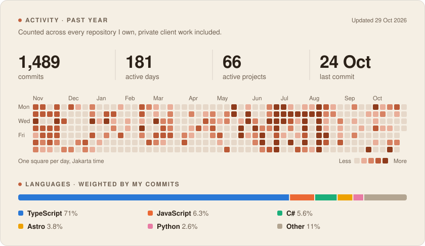

<picture>
  <source media="(prefers-color-scheme: dark)" srcset="assets/header-dark.svg">
  
</picture>

I run [**Arsya Digital Indonesia**](https://arsya.co.id), a small studio in Jakarta that designs, builds and runs digital products for businesses, from the first wireframe to the server it runs on. I still write code every day, and most of it ends up in client systems you won't find on this page.

**[Start a project →](https://arsya.co.id)** &nbsp;·&nbsp; [cs@arsya.co.id](mailto:cs@arsya.co.id) &nbsp;·&nbsp; [LinkedIn](https://linkedin.com/in/arjunaayasa) &nbsp;·&nbsp; [Instagram](https://instagram.com/arjunaayasa)

## What I build

- **AI products:** LLM gateways and API routing, AI assistants, and document intelligence for tax and legal teams.
- **Business software:** internal tools, billing and hotspot systems for ISPs, dashboards, and online exam platforms.
- **Websites and commerce:** company sites, online stores, digital product shops and payment flows.
- **Automation:** WhatsApp, Discord and Telegram bots, scrapers, and workflow automation.
- **Infrastructure:** VPS and Docker deployments, CI/CD, monitoring and Cloudflare.

## Activity

<picture>
  <source media="(prefers-color-scheme: dark)" srcset="assets/stats-dark.svg">
  
</picture>

Rebuilt every night by a GitHub Action from every repository I own. Private client work is counted but never named.

## Open source

- **[SasakLang](https://github.com/arjunaayasa/sasaklang)**: an esoteric programming language whose keywords come from Sasak, the language of Lombok. Interpreter written in Go.
- **[howisyoursecurity](https://github.com/arjunaayasa/howisyoursecurity)**: a web security scanner that runs automated checks and adds AI-assisted analysis. Python.

## Core stack

TypeScript · React · Next.js · Tailwind CSS · Node.js · Prisma · PostgreSQL · Supabase · Redis · Python · FastAPI · Playwright · Go · Rust · Docker

---

Jakarta, Indonesia · Open to new projects at [arsya.co.id](https://arsya.co.id)
